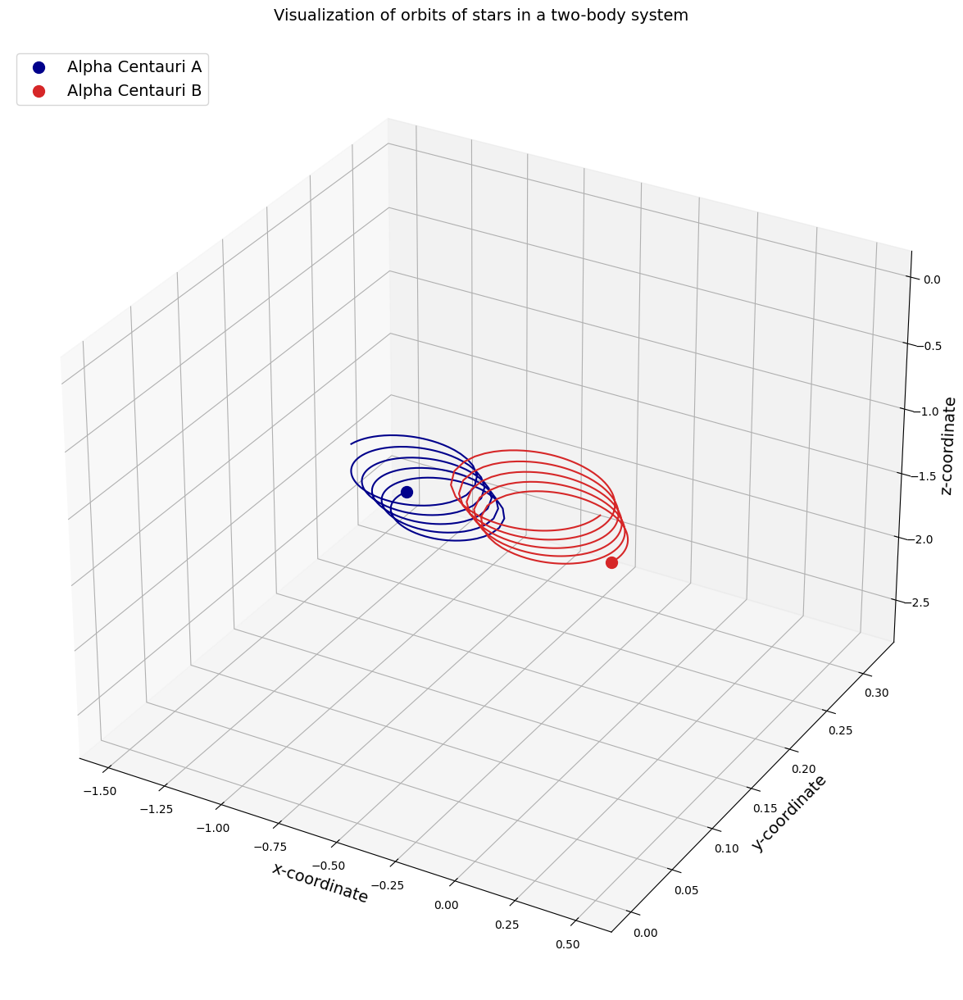

# Órbitas gravitacionales de dos cuerpos

Simulación numérica de dos masas que se atraen mediante gravitación newtoniana. El cuaderno utiliza parámetros identificados como Alpha Centauri A y B, integra sus ecuaciones de movimiento con SciPy y representa las dos trayectorias en una gráfica tridimensional.

Este repositorio conserva el cuaderno original completo: siete celdas de código, comentarios y cuatro salidas guardadas. El archivo se ha renombrado para describir su contenido; **sus bytes no se han modificado**.

[Abrir el cuaderno en Colab](https://colab.research.google.com/github/own21m/orbitas-gravitacionales-dos-cuerpos/blob/main/orbitas-gravitacionales-dos-cuerpos.ipynb) · [Consultar el notebook en GitHub](orbitas-gravitacionales-dos-cuerpos.ipynb) · [Cuaderno de procedencia](https://colab.research.google.com/drive/1bE_-pWndmL_bFdDnGDv95a5Z5k8Jyj6w)



La imagen se extrajo de una salida ya presente en el notebook. La preparación de este repositorio no volvió a ejecutar la simulación.

## Qué hace el cuaderno

1. Importa SciPy y Matplotlib.
2. Define la constante gravitacional y las magnitudes de referencia.
3. Establece las masas relativas, posiciones y velocidades iniciales; calcula el centro de masas y su velocidad.
4. Construye `TwoBodyEquations`, que devuelve las derivadas de un estado de doce componentes: dos posiciones y dos velocidades tridimensionales.
5. Integra ese estado con `scipy.integrate.odeint` en 500 puntos del intervalo de tiempo adimensional de 0 a 8.
6. Separa las posiciones de cada cuerpo y dibuja sus órbitas y posiciones finales.

El resultado es una exploración computacional de un sistema idealizado. Las etiquetas Alpha Centauri A/B identifican los parámetros del ejemplo; el cuaderno no demuestra un ajuste de las trayectorias a observaciones astronómicas.

## Modelo y escalas

Para cada cuerpo, la aceleración newtoniana depende de la masa del otro cuerpo y del vector que los separa:

$$
\ddot{\mathbf r}_1 = Gm_2\frac{\mathbf r_2-\mathbf r_1}{\lVert\mathbf r_2-\mathbf r_1\rVert^3},
\qquad
\ddot{\mathbf r}_2 = Gm_1\frac{\mathbf r_1-\mathbf r_2}{\lVert\mathbf r_1-\mathbf r_2\rVert^3}.
$$

El código integra una forma escalada de estas ecuaciones. Usa las referencias `m_nd`, `r_nd`, `v_nd` y `t_nd`, y las constantes:

$$
K_1 = \frac{G\,t_{nd}\,m_{nd}}{r_{nd}^2\,v_{nd}},
\qquad
K_2 = \frac{v_{nd}\,t_{nd}}{r_{nd}}.
$$

En las variables escaladas, las derivadas de posición son `K2 * v` y las de velocidad usan `K1` multiplicado por la masa relativa y la separación normalizada.

| Parámetro  | Valor escrito en el cuaderno       | Interpretación en el ejemplo                |
| ---------- | ---------------------------------- | ------------------------------------------- |
| `G`        | `6.67408e-11`                      | Constante gravitacional en unidades SI      |
| `m_nd`     | `1.989e30 kg`                      | Masa de referencia                          |
| `r_nd`     | `5.326e12 m`                       | Distancia de referencia                     |
| `v_nd`     | `30000 m/s`                        | Velocidad de referencia                     |
| `t_nd`     | `79.91 * 365 * 24 * 3600 * 0.51 s` | Tiempo de referencia definido por el código |
| `m1`, `m2` | `1.1`, `0.907`                     | Masas relativas de A y B                    |

Algunos comentarios originales etiquetan directamente las posiciones y velocidades iniciales como metros y metros por segundo. La presencia de `K1` y `K2` exige interpretar esos vectores junto con las escalas anteriores. Del mismo modo, el comentario de «8 orbital periods» no constituye una medición de ocho períodos: el intervalo integrado es de 0 a 8 en la variable temporal escalada.

## Tecnologías y compatibilidad

| Herramienta            | Uso en el archivo                                                                                 |
| ---------------------- | ------------------------------------------------------------------------------------------------- |
| Python                 | Definición de parámetros, ecuaciones y secuencia de cálculo                                       |
| SciPy                  | Vectores mediante sus alias históricos, norma y solución de ecuaciones diferenciales con `odeint` |
| Matplotlib             | Figura, ejes tridimensionales, trayectorias, marcadores y leyenda                                 |
| Jupyter / Google Colab | Formato `.ipynb` con código y resultados guardados                                                |

El notebook también importa `matplotlib.animation`, aunque no crea una animación en las siete celdas conservadas.

**El código depende de una API antigua de SciPy.** Utiliza `sci.array`, `sci.linspace` y `sci.concatenate`, alias de NumPy que se eliminaron del espacio principal de SciPy en la versión 1.12. Las propias salidas históricas contienen advertencias de deprecación. [Notas oficiales de SciPy 1.12](https://docs.scipy.org/doc/scipy/release/1.12.0-notes.html#expired-deprecations).

Por ello, abrir el enlace de Colab permite consultar el archivo y sus resultados, pero no garantiza que sus celdas se ejecuten en un runtime actual. Para reproducirlo sin editar el código se necesita un entorno histórico compatible con SciPy anterior a 1.12 y versiones compatibles de Python, NumPy y Matplotlib. El archivo no registra versiones exactas de esas dependencias y este repositorio no inventa un entorno de ejecución validado.

## Cómo explorarlo

1. Abre el notebook en GitHub o Colab para leer las celdas y la gráfica guardada.
2. Si vas a experimentar, trabaja en una copia y conserva el original de este repositorio.
3. Prepara un entorno compatible con la API histórica descrita arriba.
4. Ejecuta las celdas en su orden original: las ecuaciones dependen de `K1`, `K2` y de los parámetros definidos previamente.

Una futura modernización puede importar NumPy directamente para las operaciones de arrays. Esa adaptación no se ha aplicado a la copia histórica publicada aquí.

## Alcance y limitaciones del modelo

- Considera dos masas puntuales y no incluye terceros cuerpos, perturbaciones externas o correcciones relativistas.
- No implementa tratamiento de colisiones ni de la singularidad cuando la separación tiende a cero.
- No comprueba conservación de energía o momento ni realiza un estudio de convergencia del integrador.
- Calcula el centro de masas y su velocidad, pero no resta esa velocidad a las condiciones iniciales. La figura puede mostrar la traslación conjunta del sistema además de su movimiento relativo.
- Las condiciones iniciales y escalas son las del ejemplo conservado; no se presentan como una efeméride de Alpha Centauri.
- La función recibe `G` como argumento, pero utiliza los factores globales `K1` y `K2`, calculados antes de la integración.

## Conservación y validación

El archivo de procedencia se llamaba `Untitled2.ipynb`. El identificador de Google Drive y el hash de la copia están documentados en [ORIGEN.md](docs/ORIGEN.md).

La comprobación incluida solo lee el notebook: verifica su hash SHA256, estructura JSON y sintaxis Python de las celdas. No importa SciPy ni ejecuta código científico.

```sh
python scripts/verificar_cuaderno.py
```

Se verificaron siete celdas de código y cuatro salidas, con coincidencia exacta respecto al respaldo original. La sintaxis válida no certifica la compatibilidad de las dependencias ni la exactitud física del resultado.

El cuaderno no incluye una licencia ni una atribución explícita. Se conserva su contenido sin añadir una licencia nueva ni atribuir autoría exclusiva a la organización de este repositorio.

La IA se utilizó como herramienta de aceleración de procesos para organizar y documentar el proyecto.
